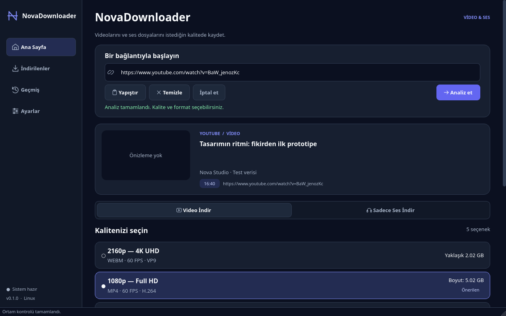
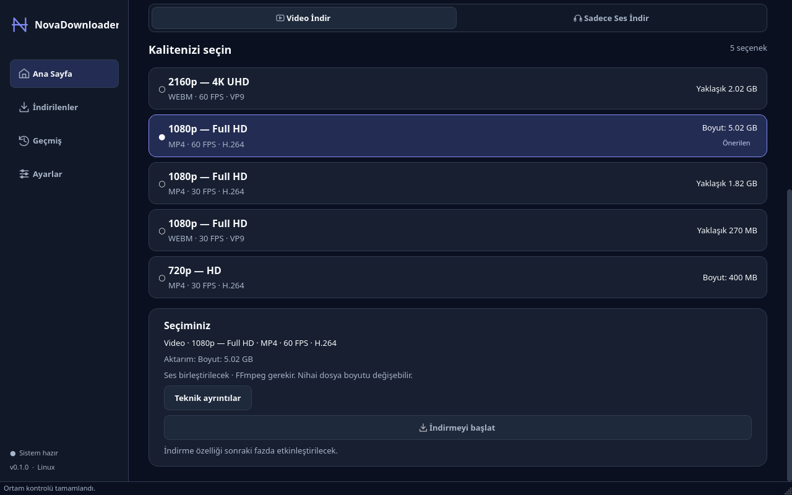
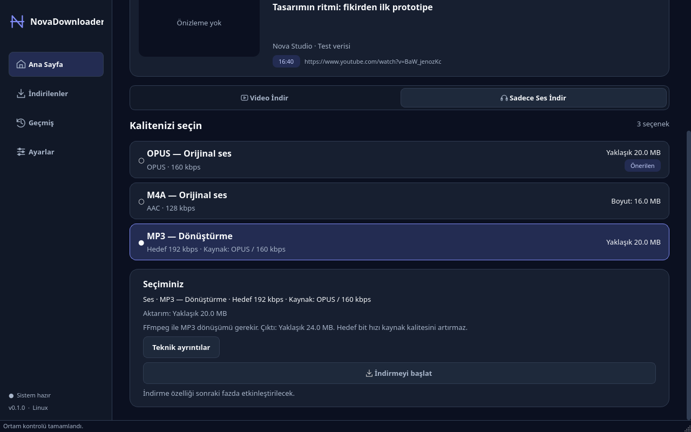

# Faz 2.3 — Arayüz akışı ve görsel doğrulama

2026-11-02. Bunlar çalışan **Qt widget'larından** alınan ekran görüntüleridir.
Video bilgileri deterministik fixture'dır; kanal alanında “Test verisi” olarak
belirtilir. Canlı YouTube veya gerçek indirme başarısı kanıtı değildir.
Görseller tek tek açılıp incelendi. Üretim uygulamasında örnek veri gösterilmez.

## İncelenen akış

| Adım | Ekran | Sonuç / gözlem |
| --- | --- | --- |
| 1 | [Boş ana sayfa](screenshots/phase2.3/01-empty.png) | Uygun. URL kartı ve bir sonraki adım açık; henüz metadata/kalite yok. |
| 2 | [Analiz yükleniyor](screenshots/phase2.3/02-loading.png) | Uygun. İndeterminate Qt göstergesi, loading butonu ve iptal erişilebilir. Bu bir indirme ilerlemesi değildir. |
| 3 | [Video sonucu](screenshots/phase2.3/03-video.png) | Uygun. 16:9 placeholder, başlık/kanal/süre ve gerçek modelden seçenekler. |
| 4 | [Kalite ve özet](screenshots/phase2.3/04-video-summary.png) | Uygun. 1080p önerisi en yüksek 2160p'den ayrı, FPS/codec farkları görünür. Kesin/tahmini aktarım ve birleştirme açıklaması var. |
| 5 | [MP3 seçimi](screenshots/phase2.3/05-audio-mp3.png) | Uygun. Kaynak 20 MB ile tahmini çıktı 24 MB ayrılıyor. FFmpeg ve kalite sınırı açık; indirme disabled. |
| 6 | [1024×700](screenshots/phase2.3/06-1024.png) | Uygun. Yatay taşma yok; alt seçenekler dikey kaydırmayla erişilebilir. |
| 7 | [640×520, uzun başlık](screenshots/phase2.3/07-640-long-title.png) | Uygun. Navigasyon kompakt; başlık üç satırda elide, tam metin tooltip/erişilebilir adda. |
| 8 | [Geçersiz URL](screenshots/phase2.3/08-error.png) | Uygun. Hata renk ve yazıyla belirtiliyor; önceki sonuç/seçim temizleniyor. |
| 9 | [İndirilenler](screenshots/phase2.3/09-downloads-placeholder.png) | Uygun. Gelecek özellik açıklaması ve çalışan geri dönüş; sahte indirme yok. Geçmiş aynı yapıyı kullanır. |
| 10 | [Ayarlar ve tanılama](screenshots/phase2.3/10-settings.png) | Uygun. Tercihler ertelenmiş, gerçek ortam kontrolü/kopyalama çalışıyor. |
| 11 | [Boş formatlar](screenshots/phase2.3/11-no-formats.png) | Uygun. Metadata korunuyor, seçenek uydurulmuyor; geçerli istek yok. |
| 12 | [1024×700, 2× DPI](screenshots/phase2.3/12-hidpi-1024.png) | Uygun. Mantıksal yerleşim korunuyor, görüntü 2048×1400 fiziksel piksel. |







## Etkileşim ve erişilebilirlik kontrolleri

- Tab/Space ile kontroller, ↑/↓/Home/End ile kalite seçimi, ←/→ ile mod geçişi.
  Otomatik test, uzun listedeki son satırın odakla görünür alana kaymasını doğrular.
- Seçim yalnızca renkle anlatılmaz: dolu işaret, checked durum ve tek seçim grubu.
  Butonlarda erişilebilir adlar, kompakt navigasyonda tooltip'ler vardır.
- URL Enter/yapıştır/temizle; loading/iptal/hata/yeniden deneme ve yeni istekte
  eski yanıtın reddi gerçek widget/worker testleriyle denetlendi.
- Mod başına geçerli seçim korunur, yeni analizde sıfırlanır. Seçim değişiminde
  ağ çağrısı yoktur. Teknik ayrıntılar isteğe bağlı açılır.
- Thumbnail bozuk veri, zaman aşımı, izin verilmeyen URL ve eski yanıt testleri
  korunmuştur. Görsel oran ve DPI/resizing için yeni test vardır.

İlk görsel turda kalite yazılarının fazla soluk kalması ve hata metninin normal
renkte görünmesi düzeltildi. Klavye testinde bulunan odak/kaydırma sorunu giderildi.
Yükleme ve durumlar ortak bileşenlerde tutulur; gereksiz animasyon eklenmedi.

## Sınırlar ve tekrar üretim

Headless Qt kontrolleri gerçek Zorin pencere yöneticisi, ekran okuyucu, fiziksel
HiDPI monitör veya canlı YouTube erişimi yerine geçmez. Tam erişilebilirlik
uygunluğu iddia edilmez. Canlı metadata/thumbnail denemesi mevcut proxy 403
nedeniyle engellidir. Bu görüntülerde thumbnail placeholder bilinçli olarak
sınanmıştır; gerçek ağdan resim yükleme başarısı gösterilmez.

Geliştirme checkout'unda:

```bash
QT_QPA_PLATFORM=offscreen .venv/bin/python scripts/capture-ui.py --output /tmp/nova-ui
QT_QPA_PLATFORM=offscreen QT_SCALE_FACTOR=2 .venv/bin/python scripts/capture-ui.py --output /tmp/nova-ui-2x
```

Betik yalnızca kendi sürecinde `VideoAnalyzer` sonucunu fixture ile değiştirir;
üretim başlangıcını değiştirmez. PNG'ler repo içindeki `docs/screenshots/phase2.3`
altında bu fazın kanıtı olarak saklanmıştır.
